

    

    &nbsp;&nbsp;&nbsp;&nbsp;

 
 
<h1 align="center"> Hello, and welcome y'all!  </h1>

<h3> Who am I and what I am? </h3>
<h4>◉ An undergraduate in <b>Computer Science</b>💻</h4>
<small><i>You wouldn't believe me if i said how much i love this area</i></small>
<h4>◉ Straight from <b>Minas Gerais, Brazil</b> 🔺🧀</h4>
<small><i>Yes, i do like cheese a lot. Yes, i say "Uai" and "trem" more than i'd like to admit. No, i don't live in a farm or have to milk a cow every morning</i></small>
<h4>◉ A <b>tech</b> and <b>programming</b> enthusiast since <i>day one</i> 🙆‍♂️</h4>
<small><i>I ain't gon' lie, but the black themed screen with colored characters is some badass Mr. Robot or Matrix or even Anonymous sh*t for me  (I still can't believe that's what's compiling and building the things we see online, that's why i love it so much)</i></small>
<h4>◉ <b>Gamer</b> in my spare time 🎮</h4>

<small><i>Minecraft, The Elder Scrolls & Fallout franchises and Terraria are peak, you can't tell me otherwise.</i></small>

 

<h3 align="center"> And at the moment... </h3>

I am <b>constantly working and battling</b> for my <b>personal</b> and <b>professional</b> improvement.

Developing my skills and creating <s>systems</s> <b>solutions</b> (either for educational or professional purposes) using: 

 
<h4> Development & Languages </h4>
 

&nbsp;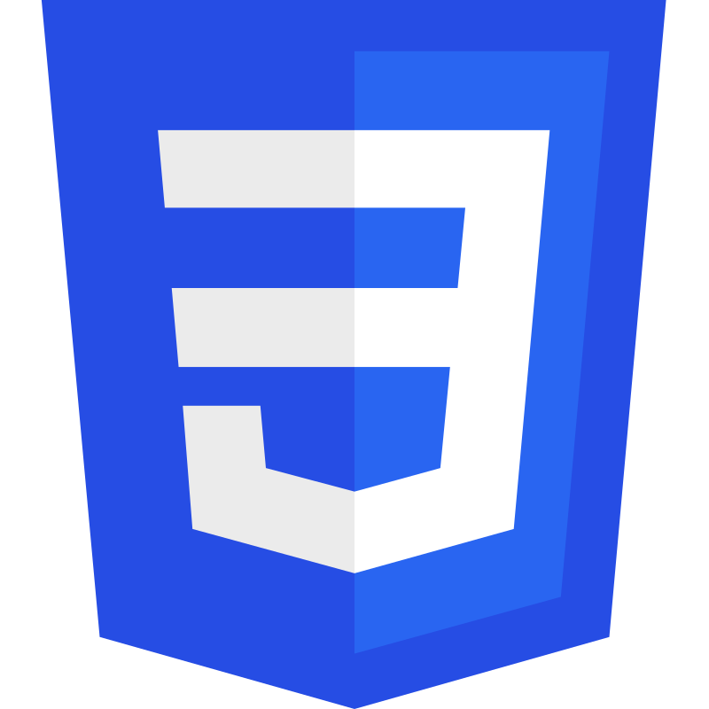&nbsp;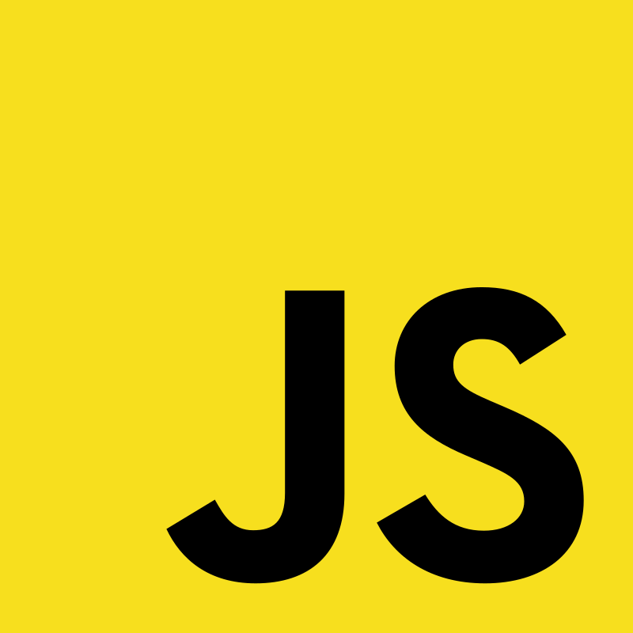&nbsp;&nbsp;&nbsp;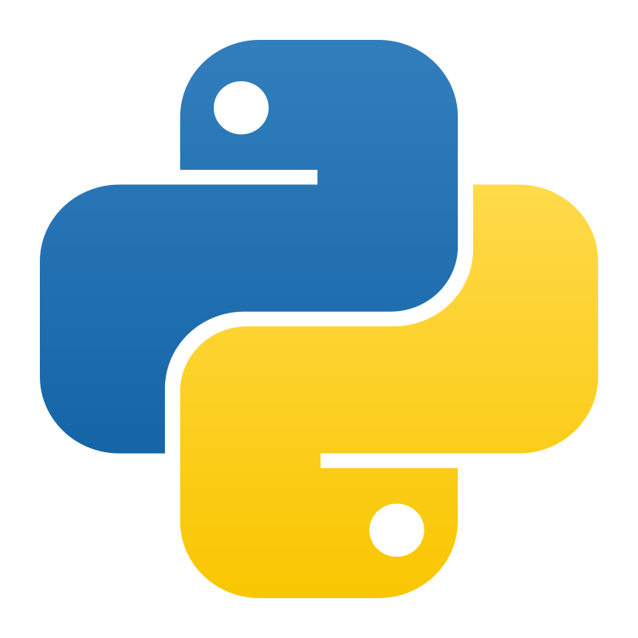&nbsp;&nbsp;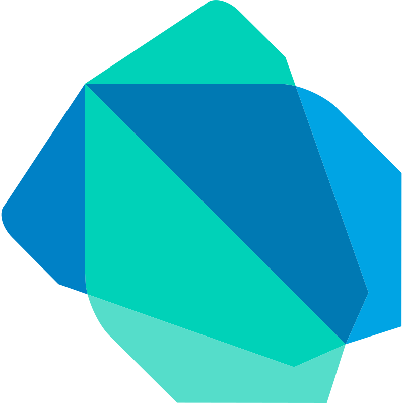&nbsp;&nbsp;&nbsp;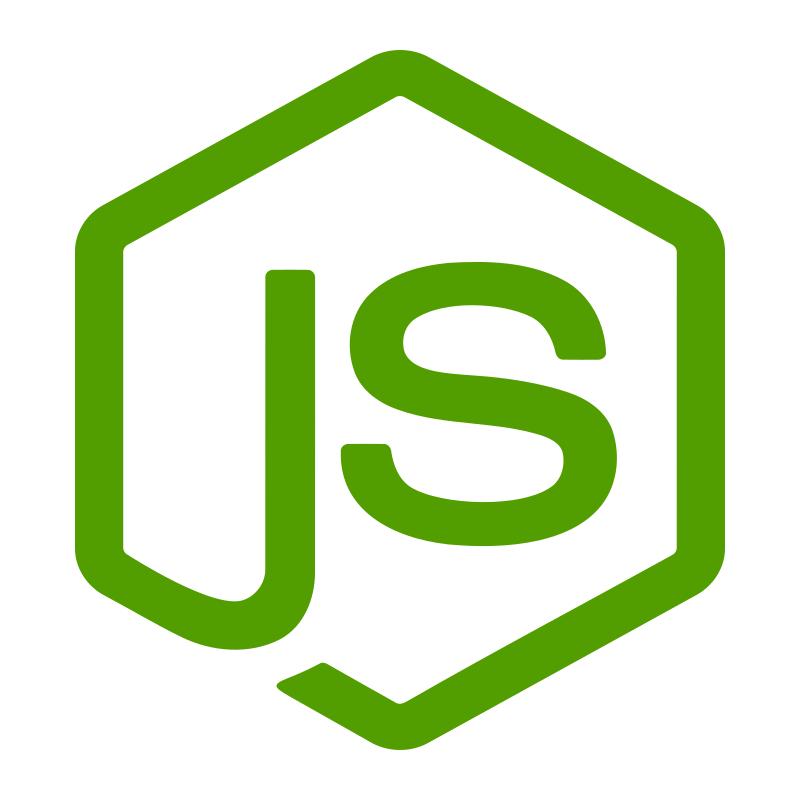&nbsp;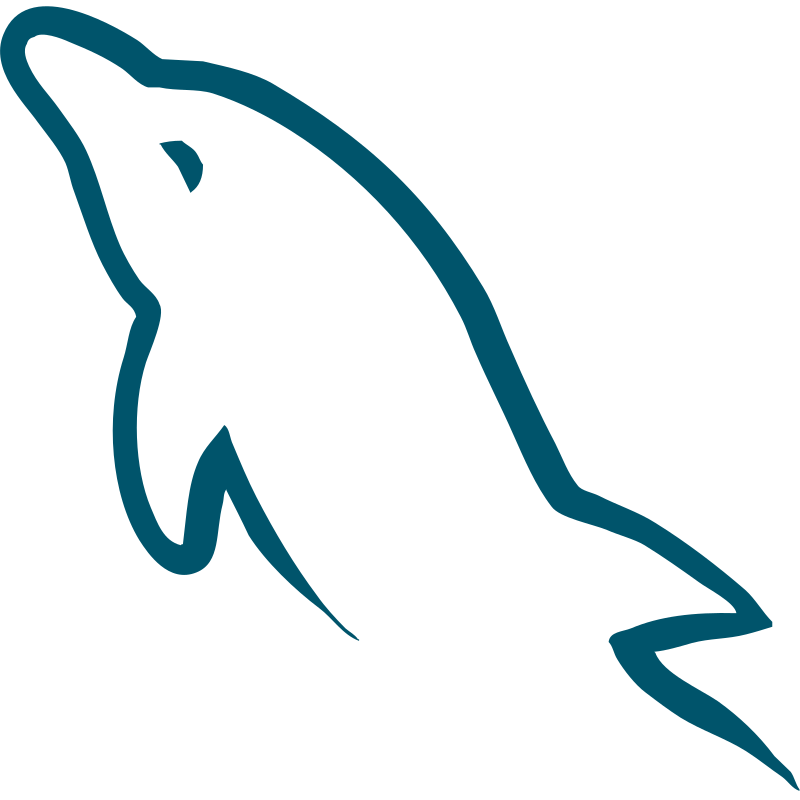&nbsp;

<h4> Tools &  Stuff </h4>
 

&nbsp;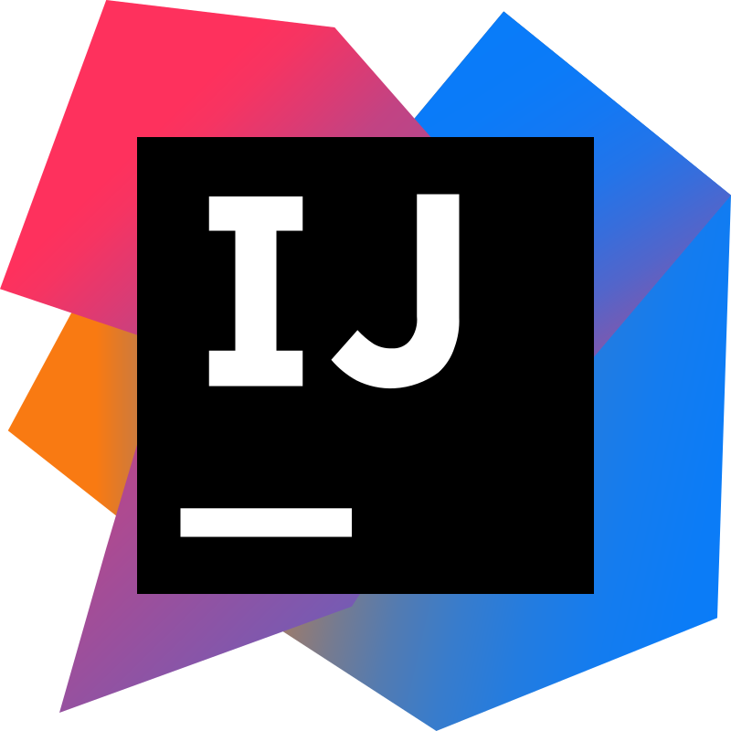&nbsp;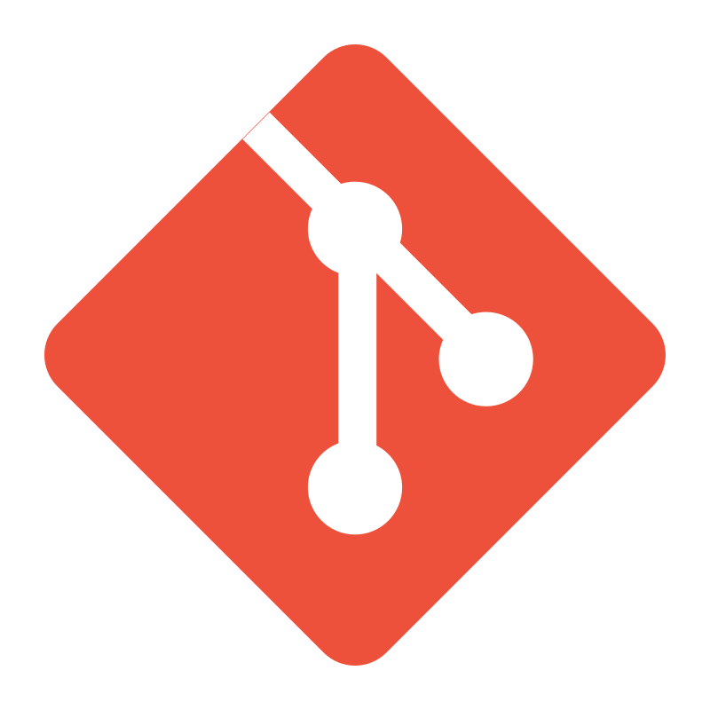&nbsp;&nbsp;&nbsp;&nbsp;&nbsp;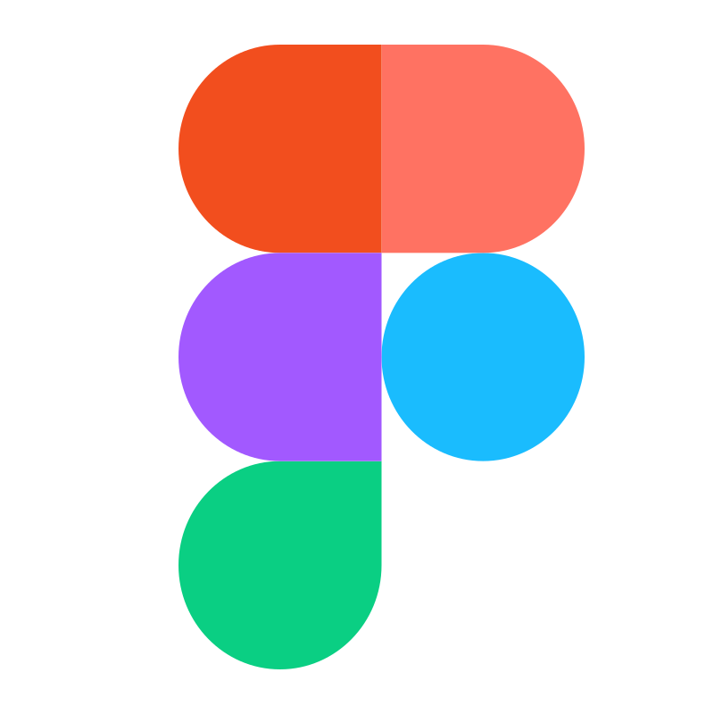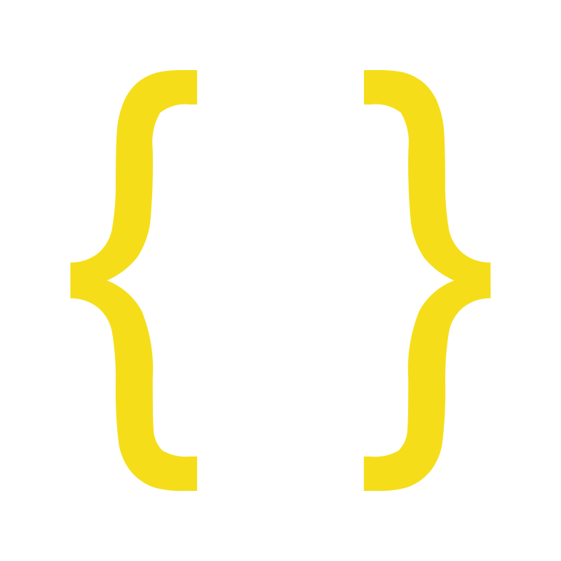&nbsp;&nbsp;&nbsp;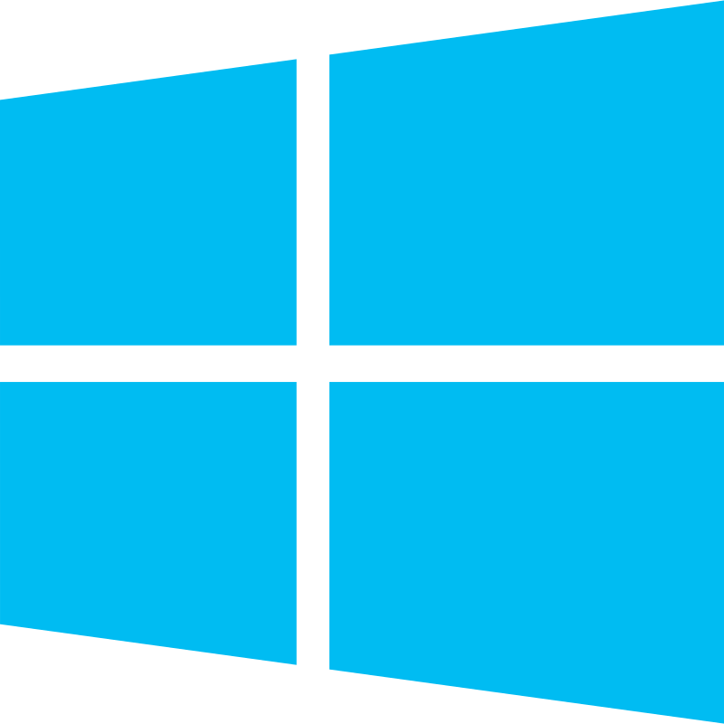

 
<h3 align="center"> Wanna chat or know me better? </h3>

 Don't you dare wait a second longer: 

    

&nbsp;

---

<b><h4 align="center"> Visit <a href="https://miguelreis.is-a.dev" target="_blank" rel="noopener noreferrer"> My Page</a>.</h4></b> 

 
 
<h4>See the projects I'm the most proud of right below 👇</h4>
<small><i>And if you find anything nice, useful or that you just like, leave a </i>⭐<i>. I'll appreciate it a lot.</i> ❤️</small>